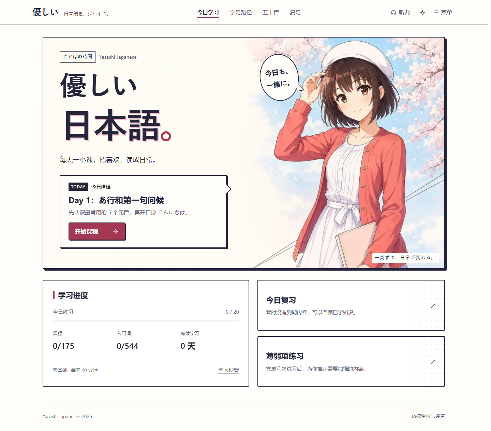
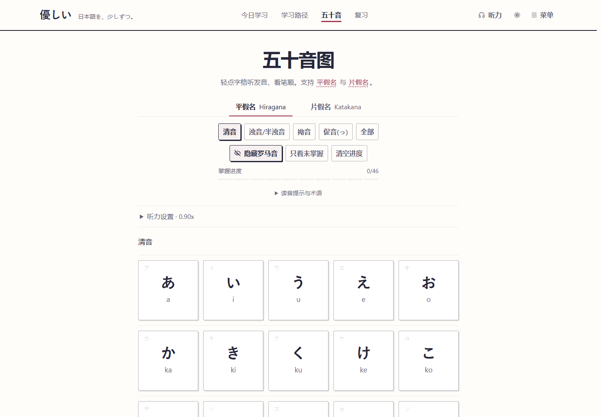
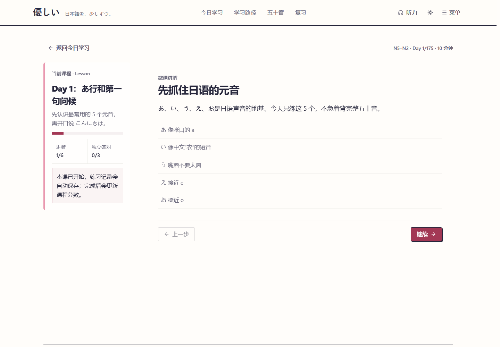
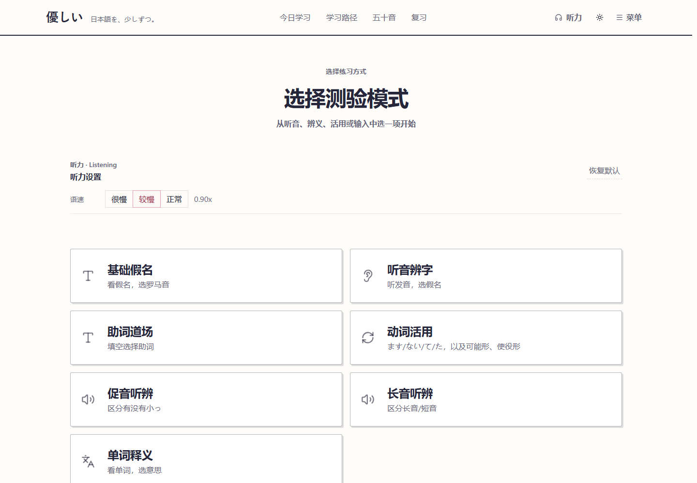
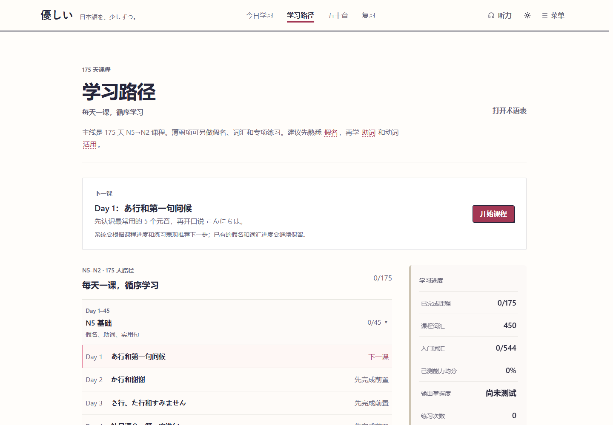
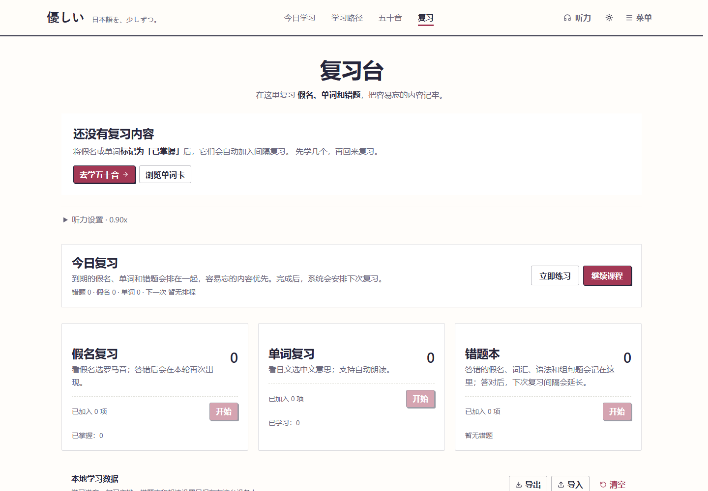

# Yasashi Japanese

The September 12 product audit examines the current visual design, navigation, simplicity and course quality. See [the audit report](docs/PRODUCT-AUDIT-2026-09-12.md) and [implementation and acceptance plan](docs/PRODUCT-OPTIMIZATION-PLAN-2026-09-12.md). The [previous functional acceptance](docs/REMEDIATION-ACCEPTANCE-2026-09-12.md) remains a historical record.

Yasashi Japanese is a gentle Japanese learning app for beginners. It covers kana, vocabulary, grammar, semantic nuance, pragmatics, quizzes, a 175-lesson N5→N2 path, local progress tracking, SRS review, and a mistake notebook. Course practice, quiz practice, and review now share the same question/result rules so progress, SRS enrollment, and mistake recording stay consistent across pages. The course is a 175-lesson N5→N2 path (lessons 1–45 N5, 46–90 N4, 91–135 N3, 136–175 N2), not a complete official JLPT dump.

The interface uses a Japanese manga colour-page design: large Gothic headings, readable body copy, warm paper, ink panel lines, and a cherry-rose accent. The current home illustration is the user's original character-in-a-text-corridor image with its subtitles cleaned up; the audit remediation preserves it. Reading and practice pages share the typography and panel treatment. See [the original corridor integration](docs/ORIGINAL-CORRIDOR-CLEANUP-2026-09-09.md). The screenshot gallery below documents the earlier September 5 design, rather than the current production preview.



*Home — an illustrated manga frontispiece with one next-lesson action, daily goal and learning progress. [Dark preview](docs/screenshots/home-manga-night.png), [mobile preview](docs/screenshots/home-manga-mobile.png).*



*Kana — hiragana and katakana charts with listening, romaji toggles, and mastery tracking.*



*Lesson — a guided lesson on the 175-lesson N5→N2 path, with examples, audio, and step progress.*



*Quiz — choose a practice mode for kana, particles, verbs, or vocabulary.*



*175-lesson path — N5→N2 stages, next-lesson recommendation, and five-dimension mastery.*



*SRS review — today's mixed queue for due kana, vocabulary, and the mistake notebook.*

## Project Layout

- This Git repository is the Next.js app root. In the historical outer workspace it appears as `web/`.
- An optional parent folder may keep dependency-free convenience scripts that forward into this app; builds never depend on files outside this repository.
- Runtime and development dependencies belong in `package.json` and are locked by `package-lock.json`.
- Learning data lives under `src/data/`; vocabulary has a single source of truth in `src/data/vocabulary/*`.
- Data validation is self-contained in `scripts/validate-data.mjs`.

## Install And Run

Use Node.js 24 (the CI runtime), then run from this app repository:

```bash
npm ci
npm run dev
```

The dev server defaults to `http://localhost:3000`.
When using the optional outer wrapper, run `npm ci --prefix web` once and use its forwarding scripts such as `npm run dev`.

## Verification

```bash
npm run validate:data  # data integrity, lesson refs, PWA/license files, legacy-source guard
npm run lint           # ESLint + Next/TypeScript rules
npm run test           # Node built-in unit tests
npm run build          # production Next build
npm run check          # validate:data + lint + test + build + HTTP smoke
npm run check:release  # check + strict browser/PWA + 23 audit browser regressions
npm run e2e            # HTTP smoke against an existing production build
npm run e2e:install    # install Playwright Chromium for browser/PWA E2E
npm run e2e:install:ci # install Playwright Chromium plus Linux system dependencies for CI
npm run e2e:browser    # optional real browser click-flow E2E on dev server; skips if Playwright is unavailable
npm run e2e:browser:required # strict browser E2E on production build/server; fails if Playwright is unavailable
npm run e2e:pwa        # optional production PWA/offline E2E; skips if Playwright is unavailable
npm run e2e:pwa:required # strict production PWA/offline E2E
npm run e2e:audit:required # 23 audit regressions against the existing production build
```

With a production server running, `node scripts/measure-home-scripts.mjs` records the JavaScript files referenced by the home document and their raw/gzip-estimated sizes. Set `E2E_BASE_URL` for another server, `BUNDLE_REPORT` for the JSON output path, and optionally `HOME_SCRIPT_GZIP_BUDGET` to enforce a byte budget. This measures initial document scripts, excluding later dynamic imports and route prefetches; it does not measure real interaction latency.

The current merge gate is `npm run check`; after building, it starts that exact production artifact with `next start` on an isolated port for the HTTP smoke gate. The GitHub Actions workflow in `.github/workflows/quality.yml` runs this gate on push and pull request. The strict browser and PWA gates use a conservative impact filter: any `src/**`, `public/**`, `scripts/**`, E2E harness, package/config, or workflow change automatically provisions Chromium with `e2e:install:ci` before running the corresponding required gate. Documentation-only and unit-test-only changes can skip those browser jobs, while new application/data/assets folders cannot silently bypass them. Data validation also checks that every core-course grammar point is reachable from lesson references, with the two intentional N4 reference-only refinements (`n4-te-iru` and `n4-te-kudasai`) documented as explicit exclusions.

Use `npm run check:release` for release environments that have Playwright and its Chromium browser installed; it runs the merge gate, strict browser click-flow and PWA/offline checks, and 23 required audit regressions. The strict `npm run e2e:browser:required` release path builds the production app and runs the click-flow suite against `next start`, while the optional `npm run e2e:browser` command keeps using a dev server for faster local checks. Strict browser-backed E2E also fails on unexpected browser `pageerror`, `console.error`, and resource request failures, with narrow allowlists for normal Next.js navigation aborts and intentional offline/PWA aborts. The audit runner uses the existing production build and records every check in `output/audit-release/summary.json`. The workflow runs it after the strict browser job and also exposes a manual full `workflow_dispatch` release run.

`npm run e2e` requires `.next/BUILD_ID` from `npm run build`, starts that production artifact with `next start` on an isolated available port, and verifies HTTP route health for the core top-level pages plus the first lesson. It never reuses the development server on port 3000. `npm run e2e:browser` exercises real interactions with Playwright, including lesson resume persistence, lesson answer recording, kana stroke playback, vocabulary search and transactional self-grading, filtered vocabulary modal behavior, dynamic vocabulary load-error retry recovery across quiz/vocabulary/review, quiz mistakes, review queue startup, PWA update refresh paths including waiting-worker `SKIP_WAITING`, and learning data backup/restore/reset. `npm run e2e:pwa` runs against a production build, waits for the service worker, simulates offline navigation, verifies the manifest and install icons online and offline, verifies the pre-cached home page, a previously visited lesson page, the learning path at `/path`, cached query deep links such as `/kana?set=yoon`, `/vocabulary?level=daily`, `/quiz?mode=hiragana-romaji`, and `/grammar?level=N5`, real cached kana/vocabulary/quiz/path/grammar/semantics/pragmatics content, a service-worker-controlled online navigation failure, and a real AnimCJK kana SVG can be served offline, and verifies the fallback page does not overwrite local learning state. Optional browser scripts exit cleanly with a skip message when the Playwright package or Chromium browser binary is missing. After `npm ci`, run `npm run e2e:install` to provision Chromium for local strict browser/PWA gates; in CI Linux runners use `npm run e2e:install:ci` so Playwright can install required system dependencies too. Use the `:required` variants or `check:release` in local release checks that must fail when the browser stack is missing.

The reference-page browser flow opens the first N5 grammar point, submits a wrong focused-practice answer, verifies the shared practice and mistake records in localStorage, and checks the completion state before continuing its keyboard-navigation assertions.

Builds may warn that `baseline-browser-mapping` or `caniuse-lite` data is stale. Treat that as dependency maintenance, not a functional failure. Actionable Next.js image performance warnings, such as full-width `sizes="100vw"` misuse or above-the-fold LCP artwork missing eager/priority loading, are blocked by `npm run build` so they cannot pass `npm run check`.

## Implemented Features

- Kana charts for hiragana/katakana, seion, dakuon, handakuon, yoon, and sokuon.
- Hiragana and katakana mastery are tracked independently with script-aware IDs such as `hiragana:a` and `katakana:a`. Existing localStorage keys are unchanged; legacy bare romaji IDs are read as the previously shared state for both scripts so existing progress is not lost.
- Kana page presentation is split into focused hero, set-hint, and section components while the page runner keeps URL controls, progress writes, and confirmation state.
- AnimCJK stroke-order animation loaded from `web/public/animcjk/kana`.
- Vocabulary cards grouped by level and category, with search, learned-state tracking, TTS, and three-way flashcard self-grading (`again` / `hard` / `good`). Self-grading records meaning practice and vocabulary SRS in one managed transaction without changing the learner's explicit mastered toggle or creating an objective mistake-notebook entry.
- Grammar, semantics, and pragmatics reference pages.
- Grammar reference keeps its static page shell server-rendered, with level selection, search, speech controls, modal navigation, and focused N5–N2 practice sessions isolated in client components.
- Quiz modes for kana recognition, audio recognition, sokuon/long-vowel contrast, particles, verb conjugation, and vocabulary meaning.
- Local SRS review for kana, vocabulary, mistakes, and correctly answered grammar/sentence knowledge. Current content revisions determine active review cards; retired question snapshots remain in history. Kanji word-reading has its own typed-answer deck and due-review notice.
- A 175-lesson N5→N2 path with practice steps, step feedback, local progress, SRS enrollment for correct kana/vocab practice, and automatic mistake notebook capture for wrong answers. Lessons 1–45 are N5: 1–21 complete hiragana (seion, dakuon, yoon, sokuon) plus katakana and long vowels, with checkpoints; 22–40 cover the N5 sentence skeleton (particles, ます/て/た/ない, adjectives, こそあど, questions, counters); 41–45 are survival scenes and graduation. Lessons 46–90 are N4, 91–135 N3, and 136–175 N2. UI course length still comes from `STARTER_LESSONS.length`; this is not a complete official JLPT dump.
- Vocabulary review questions rotate between meaning recognition, Chinese-to-Japanese recall, and audio-only listening directions; the today review queue is capped per session (mistakes first) so batch-marked words cannot flood a single review run.
- Survival greetings and high-frequency verbs ship with polite-form example sentences rendered on flashcards and in the vocabulary focus modal; the vocabulary toolbar can hide romaji to train direct kana reading.
- All 45 N5 grammar points, plus the N4/N3/N2 points on the 175-lesson path, include focused recognition questions in the grammar modal. N5 entries also have plain-language explanations and common-pitfall notes. Grammar answers use the shared question/result rules: every attempt updates practice progress, and wrong answers enter the mistake notebook without enrolling grammar into the kana/vocabulary SRS decks.
- Home translates a 5–30 minute preference into a course fragment, a bounded review round, and optional writing. Starting a plan freezes that day's tasks; review answers, course progress, and self-reported reading/writing remain distinct evidence.
- Shared learning-session helpers in `web/src/lib/learning-session.ts` and shared question helpers in `web/src/lib/questions.ts`.
- Learning backup/restore/reset helpers in `src/lib/learning-store.ts`; existing localStorage learning records remain compatible. New exports use backup schema v8 and accept v1–v7 imports. Backups include the durable activity calendar, versioned knowledge reviews and written work, daily plans, stage diagnostic history and placement, and kanji-reading records. Restore rejects unknown/non-string entries, invalid timestamps, malformed managed values, and files larger than 2 MB before mutation, then shows the backup time and data-category count and requires explicit confirmation. A valid empty backup is identified as destructive because confirming it clears current learning data.
- Learning backup export/import normalizes active kana/vocabulary indexes and SRS maps, removes stale vocabulary ids, non-reviewable kana ids, and mistake SRS entries that no longer have notebook records, while preserving practice history.
- Practice writes use the shared learning-store transaction helper so progress history, item mastery, SRS enrollment, and mistake notebook writes do not leave partial managed state after failures; this includes vocabulary flashcard self-grading. `again` schedules immediate review, `hard` shortens an advanced interval by one box without incrementing SRS right/wrong counters, and `good` advances recall mastery. Learning-store replacement events are broadcast across tabs so active review sessions stop before writing against replaced data.
- Incremental learning writes distinguish missing storage from unreadable, invalid, or structurally empty-corrupt values. They refuse to overwrite an untrusted value and compare the raw read snapshot before persistence; explicit restore/reset/confirmed clear actions remain the recovery path for replacing invalid local data. Partial rollback failures still broadcast a resync event so mounted learning hooks reload the final browser state.
- User mastery choices take precedence over scores derived from practice. Two additive exclusion keys let learners explicitly mark a derived kana or vocabulary item as not mastered without deleting practice history; the exclusions participate in backup, restore, reset, and cross-tab synchronization.
- Quiz and review routes use shared runner components plus pure question builders, so the route files stay focused on URL/session entry state.
- AnimCJK rendering is split into parser/timeline helpers (`web/src/lib/animcjk.ts`) and a glyph-board component, keeping SVG parsing testable outside React; the stroke animation component is lazy-loaded from the kana detail modal.
- Dynamic vocabulary loading helpers (`loadVocabularyLevel`, `loadVocabularyScope`) live in `web/src/data/vocabulary/loader.ts`; import that module when a route can avoid loading every level at once.
- Basic PWA installability via `manifest.webmanifest` with a stable `/` app id, 192/512 app icons, and a production service worker with separate shell, navigation, and bounded runtime-media caches. After a first install gains a controller, the client warms the current page's same-origin scripts, styles, and images so a second online reload is not required. Navigation waits at most four seconds for the network before trying the exact visited-page cache, then a canonical pathname cache for query deep links such as `/kana?set=yoon` -> `/kana`, `/vocabulary?level=daily` -> `/vocabulary`, `/quiz?mode=hiragana-romaji` -> `/quiz`, and `/grammar?level=N5` -> `/grammar`; if no cached page exists, it serves `/offline.html` instead of pretending an unknown route is available. Service-worker-controlled app links use document navigation as a fallback even when the browser reports online, so failed app-router fetches can still be recovered by the service worker. Learning state stays in `localStorage` and is not cached by the service worker. The PWA E2E verifies a lesson reached through the app's real home link can later be opened offline and that cached kana, vocabulary, quiz, path, grammar, semantics, pragmatics, and AnimCJK content still renders while offline.
- A dedicated offline fallback page at `/offline.html` for navigation requests that have not been visited/cached before the network is unavailable.

## Extending Content

The 2026-09-08 course rebuild organizes all 175 lessons into 35 thematic units. Each unit includes an original dialogue, a continuous reading, Chinese support, and vocabulary readings; each lesson has a distinct explanation, comprehension question, production task, model response, and self-check. There are 88 new reading and 87 new listening questions, and all 919 multiple-choice questions now have explanations. Level labels are teaching references, not an official exhaustive syllabus or a completion-time guarantee. Audio is device speech synthesis; open production is self-assessed. See the [research and implementation report](docs/COURSE-REDESIGN-2026-09-08.md) and [complete lesson outline](docs/COURSE-OUTLINE.md).

The 2026-09-05 maturity work adds stable per-attempt answer ordering, IME-safe input, explicitly assisted hints, and replayable lessons that retain the first completed score. Completion counts exclude courses skipped by a self-reported kana level. Mastery averages only assessed modes; untested production is labeled untested. Daily study activity survives the 300-entry detailed-history limit, but dates already evicted by older versions cannot be reconstructed.

The September 9–12 audit remediation separates completion, current lesson assessment, self-checks, and independent output. It adds targeted consolidation, all 450 declared course vocabulary items and course kana sets, versioned knowledge review with reviewed variants, goal-specific practice, saved course/stage writing, and budgeted daily plans. The 297 sentence-build questions have a frozen review record and regression examples. See [the execution plan](docs/AUDIT-REMEDIATION-PLAN-2026-09-09.md) and [the sentence-build audit](docs/SENTENCE-BUILD-AUDIT-2026-09-10.md).

`/placement` explains actual stage coverage and offers four 16-question diagnostics. Independent scores must satisfy the total, each domain, and kanji-reading thresholds before the learner can adopt lesson 46, 91, or 136 as a starting point; skipped lessons are never marked completed. These project-defined samples do not certify JLPT ability. `/checkpoints/[phase]/kanji` practices 379 distinct kanji-containing words through typed readings; `/checkpoints/[phase]` saves stage work and self-checks. See [stage placement and reading design](docs/STAGE-PLACEMENT-AND-KANJI-2026-09-11.md).

Vocabulary mounts 24 cards per page and restores filters/page in the URL. Grammar, semantic and pragmatic references offer searchable summaries and pagination. Mobile navigation includes a persistent menu and a `/settings` destination for learning preferences, speech and backup. Shared dialogs isolate their background and restore focus. The browser release gate includes 320/390/1440 layout evidence, concurrent-tab writes, and axe checks of 40 light/dark page/dialog states; automated checks do not replace manual assistive-technology testing.

All browser learning mutations must await `runLearningWrite` before reading fresh state and executing synchronous managed transactions. Replacement operations use its `replacesData` option. Do not call the asynchronous coordinator from inside its own callback. Unsupported Web Locks environments refuse writes with an explanation. See [the write protocol](docs/LEARNING-WRITE-PROTOCOL.md).

Set `NEXT_PUBLIC_SITE_URL` to the production HTTP(S) origin before building; it controls canonical, Open Graph, sitemap and robots URLs. The default is `https://yeuxjp.vercel.app`. The app has route/global error recovery and a custom 404. Diagnostic copying excludes error messages, query strings and learning records. PWA v19 pre-caches only the shell and install icons; page resources are cached when visited. The public-file precache budget is 256 KiB, excluding dynamically generated home HTML and resources warmed after navigation.

The tested framework versions are Next.js 16.3.4 and React 19.2.8. CI uses Node.js 24 and audits dependencies at moderate severity or above. Run `npm audit` when preparing a release; a zero result is a point-in-time dependency check, not a security certification. See [release and content review guidance](docs/RELEASE-READINESS.md).

- Add vocabulary to `web/src/data/vocabulary/survival.ts`, `daily.ts`, or `fluent.ts`.
- Add grammar to `web/src/data/grammar-data.ts`. Every N5–N2 grammar point must also have a matching entry in `n5GrammarPracticeSets`, `n4GrammarPracticeSets`, `n3GrammarPracticeSets`, or `n2GrammarPracticeSets` for its level; template ids, prompts, answers, and at least two unique options are required, and the answer must appear in the options.
- Add lesson steps to `web/src/data/lessons.ts` or `web/src/data/lessons/*.ts`, run `npm run generate:index`, then `npm run validate:data`. The generated lesson catalog and item display index keep full course bodies out of shared client bundles.
- Unit texts and per-lesson goals/tasks live in `src/data/coursebook/n5.ts` through `n2.ts`; `coursebook/index.ts` connects them to the existing lesson IDs. After content edits, regenerate the outline with `node scripts/export-course-outline.mjs`. `validate:data` also checks course coverage, text integrity, question options, readings and explanations. Keep IDs stable for corrections to the same activity; question fingerprints and regenerated assessment indexes invalidate outdated evidence while retaining history. Use a new ID for a genuinely new activity. Never regenerate frozen legacy snapshots from current content; see [the versioning protocol](docs/ASSESSMENT-VERSIONING-2026-09-09.md).
- Practice steps should include stable `itemId`, `itemType`, and `mode` fields so progress/SRS/mistake recording can identify the learned item.
- Reviewable kana practice uses `hiragana:<romaji>` or `katakana:<romaji>` item IDs. Phonology exercises that represent a whole word, such as `sokuon:きって`, keep their scoped custom IDs and do not enroll the single-kana SRS deck.
- Do not recreate `web/src/data/vocab-data.ts`, `kanaHira.json`, or `kanaKata.json`; validation fails if those legacy sources return.

## Assets And Licenses

AnimCJK SVG files are stored in `web/public/animcjk/`. Keep `web/public/animcjk/licenses/` when distributing the app.
