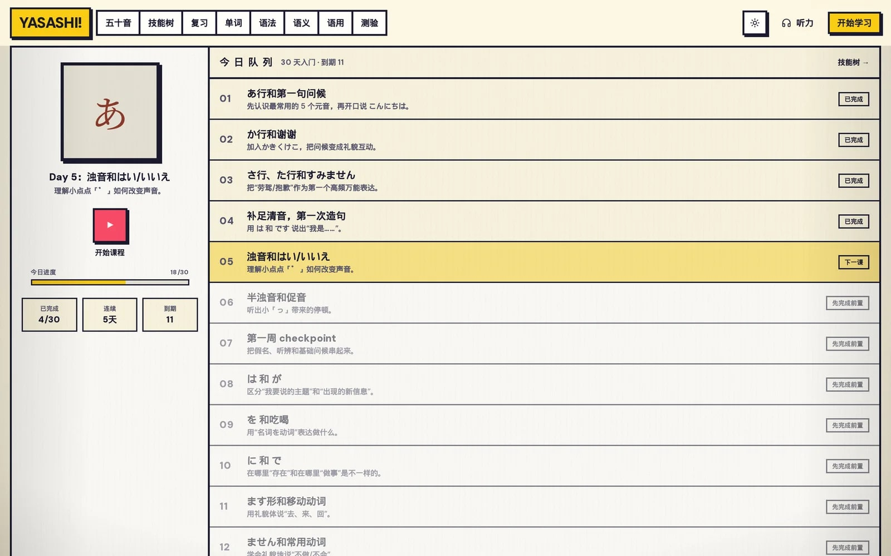

# Yasashi Japanese

A local-first Japanese learning PWA built with Next.js—covering kana with stroke-order animations, a guided 175-day N5→N2 curriculum, vocabulary and grammar references, multi-mode quizzes, and spaced-repetition review.

English · [简体中文](README.zh-CN.md)

| Home & Daily Queue | Guided 175-Day Lesson |
| --- | --- |
|  |  |

## Features

- **175-day N5→N2 curriculum** — Structured daily lessons progressing from zero-basis kana through core grammar and reading checkpoints (days 1–45 N5, 46–90 N4, 91–135 N3, 136–175 N2).
- **Kana & stroke order** — Interactive hiragana and katakana tables (seion, dakuon, handakuon, yoon, sokuon) with audio playback, romaji toggles, AnimCJK stroke-order SVGs, and independent script mastery.
- **Vocabulary & grammar references** — Level-grouped flashcards with TTS and three-grade recall (`again` / `hard` / `good`), alongside searchable N5–N2 grammar, semantic nuance, and pragmatics notes.
- **Unified SRS & mistake notebook** — Lessons, quizzes (kana, audio, pitch/length contrasts, particles, verb conjugations, vocabulary), and daily review share one state model: wrong answers automatically enter the mistake notebook and prioritize due sessions.
- **Offline PWA & local ownership** — Installable service-worker shell with offline navigation; all progress lives in browser `localStorage` with JSON backup, restore, and reset—no account or backend required.

## Quick Start

Requires **Node.js 20+**.

```bash
git clone https://github.com/zzzfu411/yeuxjp.git
cd yeuxjp
npm ci
npm run dev
```

Open `http://localhost:3000` in your browser.

## Verification

```bash
npm run validate:data  # verify curriculum, vocabulary, and asset integrity
npm run check          # data validation + ESLint + unit tests + production build + HTTP smoke
npm run e2e:install    # install Playwright Chromium (once, for browser/PWA suites)
npm run check:release  # full check + strict browser click-flow and offline PWA E2E
```

See [docs/ENGINEERING.md](docs/ENGINEERING.md) for CI gate contracts, offline service-worker routing, and content authoring rules.

## Project Structure

```text
src/
├── app/       Next.js App Router pages (home, path, lesson, kana, vocabulary, grammar, quiz, review)
├── components/ UI primitives and interactive learning runners
├── data/      Single-source curriculum lessons, vocabulary levels, and N5–N2 grammar sets
└── lib/       Transactional localStorage store, SRS scheduler, question builders, and AnimCJK parser
public/
└── animcjk/   Kana stroke-order SVGs and license notices
scripts/
└── validate-data.mjs  Build-time schema and cross-reference validator
```

## Credits

Kana stroke-order SVG data is provided by [AnimCJK](https://github.com/parsimonhi/animCJK) (see `public/animcjk/licenses/`).
