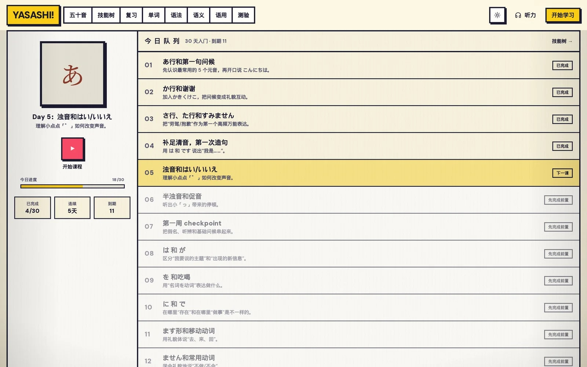
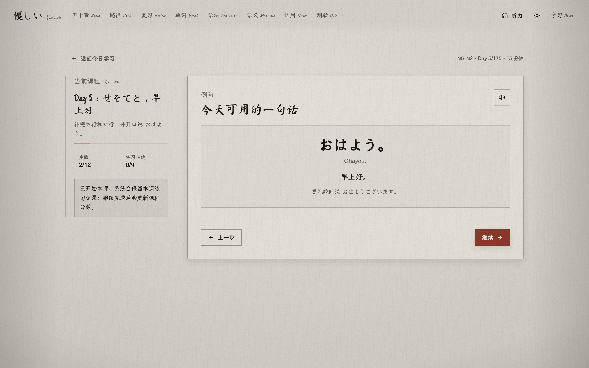

# Yasashi Japanese

基于 Next.js 构建的本地优先（Local-First）日语学习 PWA：涵盖假名笔顺动画、175 天 N5→N2 循序课程、词汇与语法参考、多模式测验，以及间隔重复（SRS）与错题本复习。

[English](README.md) · 简体中文

| 今日队列与主页 | 175 天引导式课程 |
| --- | --- |
|  |  |

## 核心特性

- **175 天 N5→N2 进阶路径** — 按日编排的闯关课程，从零基础五十音逐步过渡到句型骨架与场景表达（第 1–45 天 N5，46–90 天 N4，91–135 天 N3，136–175 天 N2）。
- **五十音与笔顺动画** — 覆盖平假名与片假名（清音、浊音、半浊音、拗音、促音），支持发音朗读、罗马音显隐切换、AnimCJK 逐笔动画演示及平/片假名独立熟练度追踪。
- **分级词库与语法辨析** — 按阶段组织的词汇闪卡（支持语音朗读与 `重来 / 吃力 / 掌握` 三档自评），配套可检索的 N5–N2 语法精讲、近义词辨析（Semantics）与语用场景（Pragmatics）。
- **统一的 SRS 与错题闭环** — 课程练习、专项测验（假名、听音、促音/长音对比、助词、动词变形、词义）与每日复习共用同一套计分与排程逻辑，答错题目自动归入错题本并优先安排复习。
- **离线可用与纯本地存储** — 支持安装为桌面/移动端 PWA 并缓存离线页面；所有学习进度保存在浏览器 `localStorage`，支持 JSON 导入备份与重置，无需注册或后端服务。

## 快速开始

环境要求：**Node.js 20+**。

```bash
git clone https://github.com/zzzfu411/yeuxjp.git
cd yeuxjp
npm ci
npm run dev
```

启动后访问 `http://localhost:3000`。

## 校验与构建

```bash
npm run validate:data  # 校验课程引用、词库结构与静态资源完整性
npm run check          # 数据校验 + ESLint + 单元测试 + 生产构建 + HTTP 冒烟测试
npm run e2e:install    # 安装 Playwright Chromium（首次运行浏览器 E2E 前执行）
npm run check:release  # 完整门禁 + 浏览器交互流与 PWA 离线 E2E 验证
```

CI 门禁细则、Service Worker 离线回退机制与题库扩充规范详见 [docs/ENGINEERING.md](docs/ENGINEERING.md)。

## 目录结构

```text
src/
├── app/        Next.js App Router 路由页（主页、路径、课程、假名、词汇、语法、测验、复习）
├── components/ 界面基础组件与交互式练习容器
├── data/       课程编排、分级词库与 N5–N2 语法题库单一数据源
└── lib/        本地事务存储、SRS 间隔排程、出题器与 AnimCJK 解析器
public/
└── animcjk/    假名笔顺 SVG 资源与开源许可声明
scripts/
└── validate-data.mjs  构建期数据契约与引用校验脚本
```

## 致谢与许可

假名笔顺 SVG 数据来自 [AnimCJK](https://github.com/parsimonhi/animCJK)（详见 `public/animcjk/licenses/`）。
